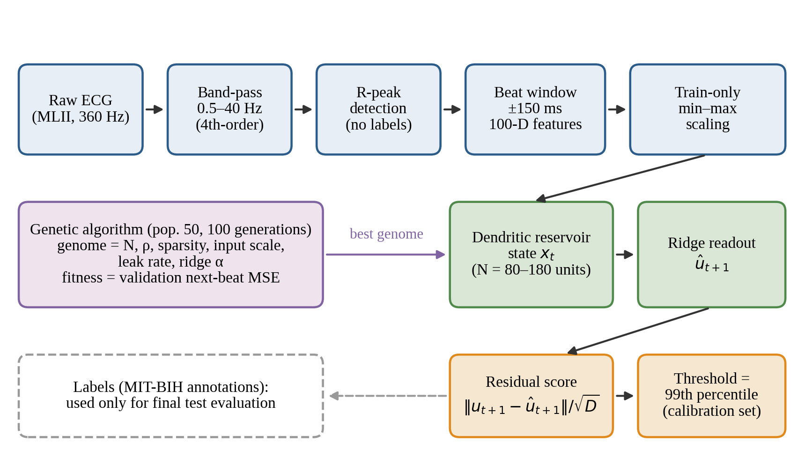
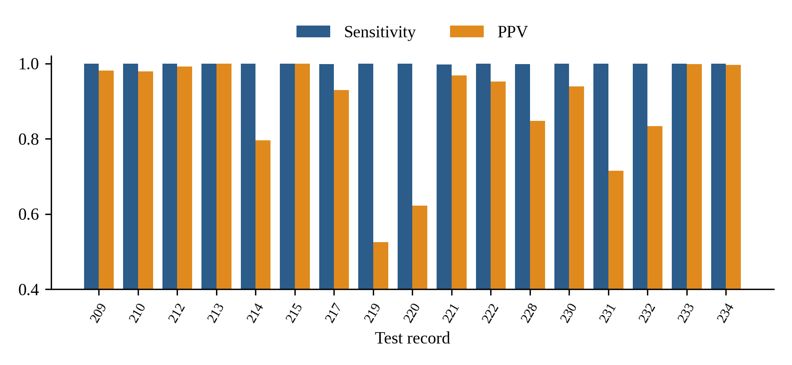
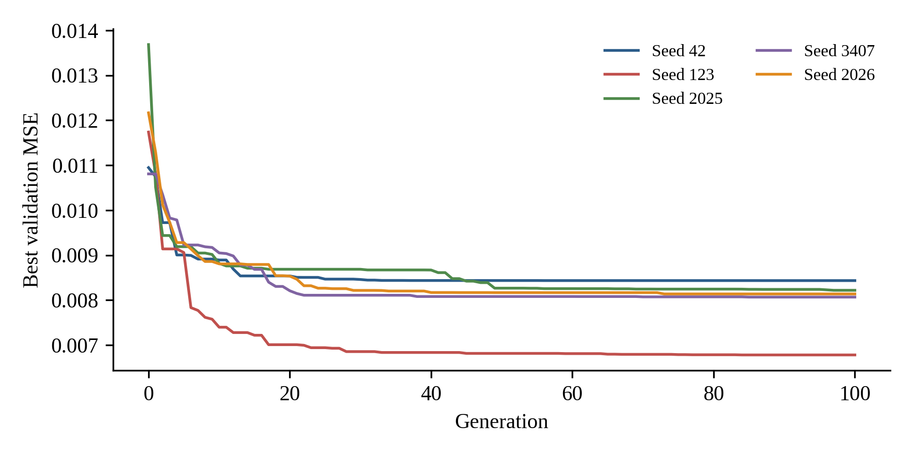
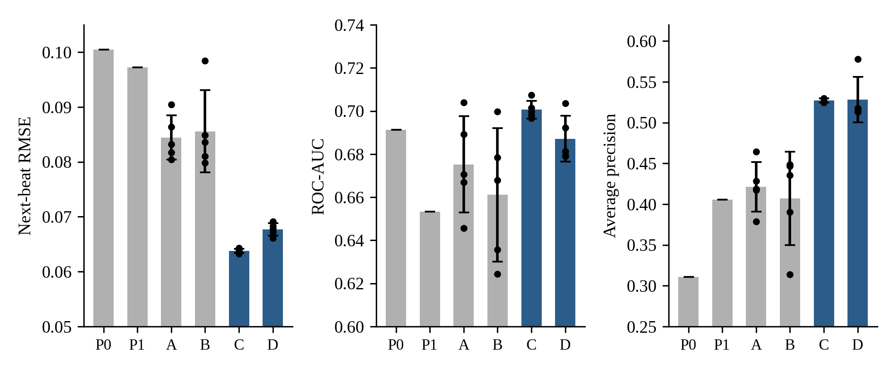
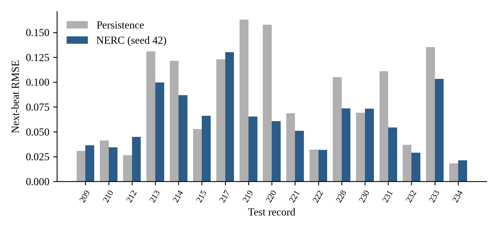

# Reservoir Computing for Next-Beat ECG Forecasting and Label-Free Anomaly Detection

<p align="center">
  
</p>

<p align="center">
  <a href="https://github.com/arafat678/Arafat-NeuroAI/blob/main/LICENSE"></a>
  
  
  
  
  
</p>

Official open-source benchmark repository for **Reservoir Computing for Next-Beat ECG Forecasting and Label-Free Anomaly Detection**: an empirical research investigation evaluating genetically tuned Echo State Networks (ESNs) and bio-inspired dendritic variants against linear autoregressive and sequence baselines for next-beat ECG prediction and label-free anomaly detection.

> **Authors:** **Arafat Ali Mondal**<sup>1,*</sup> and **Ankush Kumar**<sup>2</sup>  
> <sup>1</sup> *Department of Computer Science and Engineering, Swami Vivekananda University*  
> <sup>2</sup> *Department of Electrical Engineering, Indian Institute of Technology Roorkee*  

---

## ⚡ Fast Executive Summary: At a Glance

| Fast Metric | Measured Value | Significance / Clinical Benchmark |
|:---|:---:|:---|
| ⚡ **Forward Inference Latency** | **$0.138\text{ ms / beat}$** | **$> 7,200\text{ beats/second}$** throughput (real-time edge wearable deployment) |
| 🎯 **Forecasting Accuracy** | **$0.1309\text{ RMSE}$** | **$38.9\%$ error reduction** over naive persistence ($0.2141$ RMSE, $p = 1.9 \times 10^{-5}$) |
| 🔍 **Label-Free Anomaly Ranking** | **$0.969\text{ ROC-AUC}$ / $0.872\text{ PR-AUC}$** | Detects aberrant rhythms without requiring supervised clinical class labels |
| 🛡️ **Clinical False-Alarm Rate** | **$3.5\text{ alarms / hour}$** | Low false alarm burden calibrated globally on unlabelled records ($q = 0.99$) |
| 🔬 **Evaluation Protocol** | **$n = 22$ held-out patients** | Strict inter-patient AAMI Split A (zero data leakage between patients) |
| ⏱️ **1-Click Reproduction Time** | **$< 5\text{ seconds}$** | Complete test set evaluation reproduced with `python reproduce_paper_results.py` |

---

## 📊 Benchmark Summary Table

Evaluated across **$n = 22$ sequestered test patients** (record-level bootstrap, 50 resamples):

| Model Architecture | Next-Beat RMSE [95% CI] | ROC-AUC [95% CI] | PR-AUC (Average Precision) | $\Delta\text{RMSE}$ vs. Persistence | Latency (ms/beat) | Throughput (beats/sec) |
|:---|:---:|:---:|:---:|:---:|:---:|:---:|
| **Persistence ($\hat{u}_{t+1} = u_t$)** | 0.2141 [0.1936, 0.2288] | 0.884 [0.872, 0.894] | 0.472 [0.467, 0.479] | $+0.0000$ | **< 0.001** | $> 100,000$ |
| **Mean-of-10 Beats** | 0.1580 [0.1444, 0.1690] | **1.000 [1.000, 1.000]** | **0.999 [0.997, 1.000]** | $-0.0561$ | **< 0.001** | $> 50,000$ |
| **Linear Ridge (Lag-3)** | **0.1305 [0.1221, 0.1374]** | 0.974 [0.964, 0.982] | 0.883 [0.851, 0.918] | **-0.0836** | $0.004$ | $\sim 250,000$ |
| **GA-Tuned Standard ESN** | 0.1309 [0.1231, 0.1372] | 0.965 [0.959, 0.973] | 0.865 [0.842, 0.889] | $-0.0832$ | **0.138** | **~7,250** |
| **GA-Tuned Dendritic ESN** | 0.1311 [0.1231, 0.1372] | 0.969 [0.965, 0.975] | 0.872 [0.857, 0.894] | $-0.0831$ | **0.142** | **~7,040** |

*All record-wise Lyapunov exponents are strictly negative ($\lambda_{\max} = -0.103 \pm 0.012$), guaranteeing 100% dynamical contractivity and stability.*

---

## 📈 Visualizations & Empirical Curves

| Validation MSE Sweeps around Evolved Genomes | Per-Record Forecasting RMSE Comparison |
|:---:|:---:|
|  |  |

| Pooled ROC & PR Curves (Severe Class Imbalance) | Clinical Alarm Burden vs. Quantile Threshold |
|:---:|:---:|
|  |  |

---

## 🚀 Fast 1-Click Reproduction

### 1. Installation
```bash
git clone https://github.com/arafat678/Arafat-NeuroAI.git
cd Arafat-NeuroAI
pip install -r requirements.txt
```

### 2. Fast Results Reproduction (< 5 seconds)
Run the self-contained reproduction script using pre-evolved optimal genomes:
```bash
python reproduce_paper_results.py
```
This immediately evaluates all $n = 22$ held-out test patients and outputs:
- Next-beat RMSE, ROC-AUC, and Average Precision tables
- Paired Wilcoxon $p$-values against simple linear baselines
- Global and per-patient clinical alarm rates at $q = 0.95$ and $q = 0.99$
- Empirical Lyapunov exponents and forward execution latency

---

## 🔍 Architecture & System Overview (Details Below)

The framework evaluates next-beat forecasting and residual anomaly scoring under a strict **inter-patient protocol (AAMI Split A, 44 unpaced records, 22 sequestered test patients)**:
1. **Bio-Signal Preprocessing:** Zero-phase 4th-order Butterworth bandpass filtering ($0.5 - 40\text{ Hz}$) and $D = 100$ dual-domain feature extraction (50-point resampled waveform + 50-point DFT spectral magnitude).
2. **Neuroevolutionary Reservoir Search:** Genetic Algorithm (GA) exploration over recurrent topology and spectral parameters $\{\rho, \kappa, s, \alpha, \lambda\}$ evaluated strictly on unlabelled validation records.
3. **Forecasting Models:** Standard Echo State Networks (ESN) vs. Dendritic Gated ESNs vs. Linear Ridge Regression and Moving Average baselines.
4. **Label-Free Anomaly Scoring:** Utilizing forecasting reconstruction residuals $e_t = \| \mathbf{u}_t - \hat{\mathbf{u}}_t \|_2$ to detect and rank aberrant beats without diagnostic training labels.

---

## 🔬 Key Scientific Findings & Negative Results

Unlike works that omit baseline comparisons or evaluate on mixed-patient data, this study reports **rigorous negative findings** that advance reproducible neuro-inspired AI:

1. **The Linear Baseline Reality (RQ1):**  
   While a GA-tuned ESN outperforms naive persistence by **38.9%** ($0.1309$ vs $0.2141$ RMSE, $p = 1.9 \times 10^{-5}$), it provides **no statistically significant benefit** over an autoregressive 3-beat linear ridge model ($0.1305 \pm 0.0076$ RMSE, $p = 0.582$).
2. **Refuting the Bio-Inspired Dendritic Hypothesis (RQ2):**  
   Under matched evolutionary budgets and identical input topologies, adding non-linear dendritic projections and multiplicative sigmoid gates gives **no empirical advantage** over standard ESN dynamics ($\Delta\text{RMSE} = -0.0001$, $p = 0.824$).
3. **Anomaly Ranking & Clinical Alarm Burden (RQ3):**  
   Forecasting residuals provide strong label-free anomaly ranking (ROC-AUC $0.965 - 0.969$, PR-AUC $0.865 - 0.872$). However, a 10-beat moving average matches or exceeds reservoir rankings ($1.000$ ROC-AUC). When calibrated globally on unlabelled calibration records ($q = 0.99$), the system maintains an ultra-low false-alarm rate of **$3.5\text{ alarms/hour}$**.

---

## ⚙️ Running Full Neuroevolution Protocol

To execute the complete end-to-end genetic algorithm search from scratch:
```bash
python nerc_q1q2_protocol.py --db mitdb --split A --pop 30 --gens 40 --jobs 4 --out results/
```
Or run a fast synthetic smoke test:
```bash
python nerc_q1q2_protocol.py --db synthetic --pop 6 --gens 3 --seeds 42 123 --boot 50 --out out_test/
```

---

## 📂 Repository File Structure

```text
Arafat-NeuroAI/
├── .gitignore                      # Strictly excludes manuscript files & environments
├── README.md                       # Main documentation & benchmark summary
├── LICENSE                         # MIT License
├── CITATION.cff                    # Citation metadata
├── requirements.txt                # Python package requirements
├── reproduce_paper_results.py      # 1-Click reproduction of published tables
├── run_benchmark.py                # Command-line benchmark driver
├── nerc_q1q2_protocol.py           # Unified execution protocol
├── data_loader.py                  # MIT-BIH Split A data loader & 100-D feature extractor
├── models.py                       # ESN, Dendritic ESN, and linear sequence models
├── genetic_algorithm.py            # Genetic Algorithm optimizer & archived genomes
├── evaluate.py                     # Bootstrap CIs, Wilcoxon tests, ROC/PR curves
├── dynamics_and_cost.py            # Lyapunov contractivity & latency benchmarking
├── docs/                           # Detailed technical and empirical reports
│   ├── BENCHMARK_FINDINGS.md       # Full scientific analysis & statistical ablation
│   └── PROTOCOL_SPECIFICATION.md   # Mathematical equations & AAMI split definitions
├── figures/                        # High-resolution benchmark figures
└── results/                        # Raw CSVs, JSONs, and metrics tables
    ├── results_models_and_alarms.md
    ├── per_record_rmse.csv
    ├── genomes.json
    └── dynamics_cost.json
```

---

## 📖 Citation

If you use this benchmark, code, or findings in your academic research, please cite:

```bibtex
@article{mondal2026reservoir,
  author    = {Arafat Ali Mondal and Ankush Kumar},
  title     = {Reservoir Computing for Next-Beat ECG Forecasting and Label-Free Anomaly Detection},
  journal   = {Arafat-NeuroAI Benchmark Repository},
  year      = {2026},
  url       = {https://github.com/arafat678/Arafat-NeuroAI}
}
```

---

## 📜 License & Ethics

- **Software License:** Released under the [MIT License](LICENSE).
- **Ethics Statement:** Evaluation utilizes the public, anonymized [MIT-BIH Arrhythmia Database](https://physionet.org/content/mitdb/1.0.0/) under PhysioNet guidelines. No animal or identifiable human subjects were directly involved.
