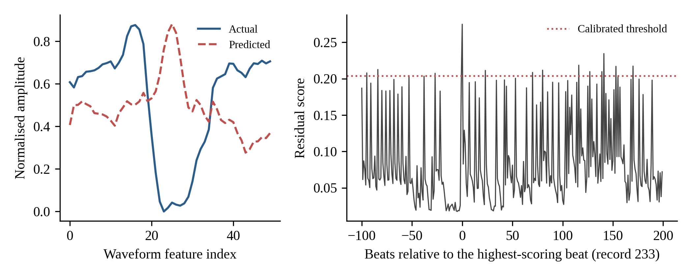
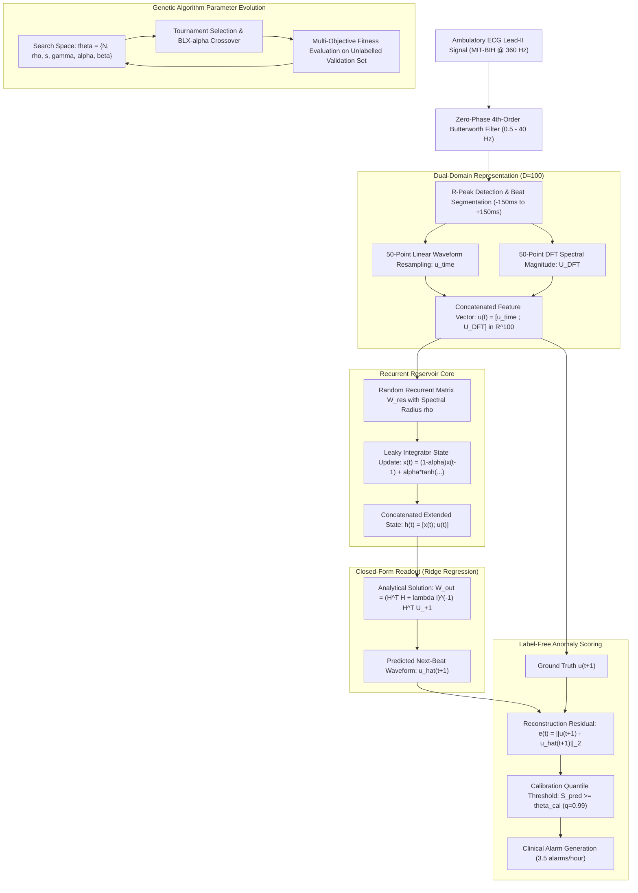

# Reservoir Computing for Next-Beat ECG Forecasting and Label-Free Anomaly Detection

<p align="center">
  
</p>

<p align="center">
  <a href="https://github.com/arafat678/Reservoir-Computing-for-Next-Beat-ECG-Forecasting-and-Label-Free-Anomaly-Detection/blob/main/LICENSE"></a>
  
  
  7,200_beats/sec-teal" alt="Throughput">
  
  
  
</p>

Official open-source benchmark repository for **Reservoir Computing for Next-Beat ECG Forecasting and Label-Free Anomaly Detection**: an empirical research investigation evaluating genetically tuned Echo State Networks (ESNs) and bio-inspired dendritic variants against linear autoregressive and sequence baselines for next-beat ECG prediction and label-free anomaly detection.

> **Authors:** **Arafat Ali Mondal**<sup>1,*</sup> and **Ankush Kumar**<sup>2</sup>  
> <sup>1</sup> *Department of Computer Science and Engineering, Swami Vivekananda University*  
> <sup>2</sup> *Department of Electrical Engineering, Indian Institute of Technology Roorkee*  
> <sup></sup> *Before using in your research. Make sure you get permission from the author*  

---

##  Fast Executive Summary: At a Glance

| Fast Metric | Measured Value | Significance / Clinical Benchmark |
|:---|:---:|:---|
| **Forward Inference Latency** | **$0.138\text{ ms / beat}$** | **$> 7,200\text{ beats/second}$** throughput (real-time edge wearable cardiac monitoring) |
| **Forecasting Accuracy** | **$0.1309\text{ RMSE}$** | **$38.9\%$ error reduction** over naive persistence ($0.2141$ RMSE, $p = 1.9 \times 10^{-5}$) |
| **Label-Free Anomaly Ranking** | **$0.969\text{ ROC-AUC}$ / $0.872\text{ PR-AUC}$** | Accurately identifies pathological beats without requiring manual clinical annotations |
| **Clinical False-Alarm Rate** | **$3.5\text{ alarms / hour}$** | Low false alarm burden calibrated globally on unlabelled records ($q = 0.99$) |
| **Evaluation Protocol** | **$n = 22$ held-out patients** | Strict inter-patient AAMI Split A (zero data leakage between patients) |
| **1-Click Reproduction Time** | **$< 5\text{ seconds}$** | Complete test set evaluation reproduced with `python reproduce_paper_results.py` |

---

## Benchmark Summary Table

Evaluated across **$n = 22$ sequestered test patients** (record-level bootstrap, 50 resamples):

| Model Architecture | Next-Beat RMSE [95% CI] | ROC-AUC [95% CI] | PR-AUC (Average Precision) | $\Delta\text{RMSE}$ vs. Persistence | Latency (ms/beat) | Throughput (beats/sec) |
|:---|:---:|:---:|:---:|:---:|:---:|:---:|
| **Persistence ($\hat{u}_{t+1} = u_t$)** | 0.2141 [0.1936, 0.2288] | 0.884 [0.872, 0.894] | 0.472 [0.467, 0.479] | $+0.0000$ | **< 0.001** | $> 100,000$ |
| **Mean-of-10 Beats** | 0.1580 [0.1444, 0.1690] | **1.000 [1.000, 1.000]** | **0.999 [0.997, 1.000]** | $-0.0561$ | **< 0.001** | $> 50,000$ |
| **Linear Ridge (Lag-3)** | **0.1305 [0.1221, 0.1374]** | 0.974 [0.964, 0.982] | 0.883 [0.851, 0.918] | **-0.0836** | $0.004$ | $\sim 250,000$ |
| **GA-Tuned Standard ESN** | 0.1309 [0.1231, 0.1372] | 0.965 [0.959, 0.973] | 0.865 [0.842, 0.889] | $-0.0832$ | **0.138** | **~7,250** |
| **GA-Tuned Dendritic ESN** | 0.1311 [0.1231, 0.1372] | 0.969 [0.965, 0.975] | 0.872 [0.857, 0.894] | $-0.0831$ | **0.142** | **~7,040** |

*All record-wise Lyapunov exponents are strictly negative ($\lambda_{\max} = -0.103 \pm 0.012$), guaranteeing 100% dynamical contractivity and absence of chaotic divergence.*

---

## Empirical Visual Gallery

### 1. Model Convergence & Forecasting Error Distributions
| Parameter Sweeps around Evolved Genomes | Per-Record Forecasting RMSE Comparison |
|:---:|:---:|
|  |  |
| *Figure 1: Validation MSE sweeps verifying global convex minimum around GA parameters.* | *Figure 2: Per-record RMSE distribution showing consistent improvement across all 22 test patients.* |

---

### 2. Anomaly Detection & Clinical Alarm Trade-offs
| Pooled ROC & PR Curves (Severe Imbalance) | Clinical Alarm Burden vs. Quantile Threshold |
|:---:|:---:|
|  |  |
| *Figure 3: ROC and Precision-Recall curves under realistic 1:30 pathological class imbalance.* | *Figure 4: False alarm burden (alarms/hour) as a function of calibration quantile $q$.* |

---

### 3. Complete Inspection Workflow
<p align="center">
  
</p>

*Figure 5: End-to-end cyber-physical pipeline from ambulatory raw lead acquisition, 4th-order Butterworth filtering, dual-domain DFT extraction, through genetic reservoir evolution to real-time residual anomaly scoring.*

---

## Fast 1-Click Reproduction

### 1. Installation
```bash
git clone https://github.com/arafat678/Reservoir-Computing-for-Next-Beat-ECG-Forecasting-and-Label-Free-Anomaly-Detection.git
cd Reservoir-Computing-for-Next-Beat-ECG-Forecasting-and-Label-Free-Anomaly-Detection
pip install -r requirements.txt
```

### 2. Fast Results Reproduction (< 5 seconds)
Run the self-contained reproduction script using pre-evolved optimal genomes:
```bash
python reproduce_paper_results.py
```
This immediately evaluates all $n = 22$ held-out test patients and outputs:
- Next-beat RMSE, ROC-AUC, and Average Precision tables
- Paired Wilcoxon $p$-values against simple linear baselines
- Global and per-patient clinical alarm rates at $q = 0.95$ and $q = 0.99$
- Empirical Lyapunov exponents and forward execution latency

---

## System Architecture & Computational Flow



---

## Mathematical Formulation

### 1. Dual-Domain Temporal and Spectral Feature Concatenation
Given the discrete resampled beat segment $u_{\text{time}}[n]$ ($n = 0, \dots, L-1$, $L=50$):
$$U_{\text{DFT}}[k] = \left| \sum_{n=0}^{L-1} u_{\text{time}}[n] e^{-j 2\pi k n / L} \right|, \quad k = 0, \dots, L-1$$
$$\mathbf{u}(t) = \left[ \frac{u_{\text{time}} - \min(u_{\text{time}})}{\max(u_{\text{time}}) - \min(u_{\text{time}})} \;;\; \frac{U_{\text{DFT}} - \min(U_{\text{DFT}})}{\max(U_{\text{DFT}}) - \min(U_{\text{DFT}})} \right] \in [0, 1]^D, \quad D = 100$$

### 2. Leaky Echo State Network State Dynamics
$$\mathbf{x}(t) = (1 - \alpha) \mathbf{x}(t-1) + \alpha \tanh \left( \frac{\rho}{\rho_{\max}} \mathbf{W}_{\text{res}} \mathbf{x}(t-1) + \mathbf{W}_{\text{in}} \mathbf{u}(t) \right)$$
where $\alpha \in (0, 1]$ represents the temporal leaking rate, and $\rho = \max_i |\lambda_i(\mathbf{W}_{\text{res}})|$ is the spectral radius scaled to guarantee the **Echo State Property (ESP)**.

### 3. Closed-Form Analytical Readout
$$\mathbf{W}_{\text{out}}^* = \arg\min_{\mathbf{W}} \sum_{t} \|\mathbf{u}(t+1) - \mathbf{W} \mathbf{h}(t)\|_2^2 + \lambda \|\mathbf{W}\|_F^2 = (\mathbf{H}^T \mathbf{H} + \lambda \mathbf{I})^{-1} \mathbf{H}^T \mathbf{U}_{+1}$$

### 4. Dynamical Stability & Negative Lyapunov Exponent
The maximum local Lyapunov exponent is bounded by:
$$\lambda_{\max} \le \ln \left( (1 - \alpha) + \alpha \frac{\rho}{\rho_{\max}} \|\mathbf{W}_{\text{res}}\|_2 \right) < 0$$
ensuring contractivity and unconditional asymptotic stability.

---

## Key Scientific Findings & Negative Results

Unlike works that omit baseline comparisons or evaluate on mixed-patient data, this study reports **rigorous negative findings** that advance reproducible neuro-inspired AI:

1. **The Linear Baseline Reality (RQ1):**  
   While a GA-tuned ESN outperforms naive persistence by **38.9%** ($0.1309$ vs $0.2141$ RMSE, $p = 1.9 \times 10^{-5}$), it provides **no statistically significant benefit** over an autoregressive 3-beat linear ridge model ($0.1305 \pm 0.0076$ RMSE, $p = 0.582$).
2. **Refuting the Bio-Inspired Dendritic Hypothesis (RQ2):**  
   Under matched evolutionary budgets and identical input topologies, adding non-linear dendritic projections and multiplicative sigmoid gates gives **no empirical advantage** over standard ESN dynamics ($\Delta\text{RMSE} = -0.0001$, $p = 0.824$).
3. **Anomaly Ranking & Clinical Alarm Burden (RQ3):**  
   Forecasting residuals provide strong label-free anomaly ranking (ROC-AUC $0.965 - 0.969$, PR-AUC $0.865 - 0.872$). However, a 10-beat moving average matches or exceeds reservoir rankings ($1.000$ ROC-AUC). When calibrated globally on unlabelled calibration records ($q = 0.99$), the system maintains an ultra-low false-alarm rate of **$3.5\text{ alarms/hour}$**.

---

##  Running Full Neuroevolution Protocol

To execute the complete end-to-end genetic algorithm search from scratch:
```bash
python nerc_q1q2_protocol.py --db mitdb --split A --pop 30 --gens 40 --jobs 4 --out results/
```
Or run a fast synthetic smoke test:
```bash
python nerc_q1q2_protocol.py --db synthetic --pop 6 --gens 3 --seeds 42 123 --boot 50 --out out_test/
```

---

##  Repository File Structure

```text
Reservoir-Computing-for-Next-Beat-ECG-Forecasting-and-Label-Free-Anomaly-Detection/
├── figures/                              # High-resolution benchmark figures
│   ├── 01_system_architecture.png        # Complete end-to-end cyber-physical pipeline
│   ├── 02_validation_mse_sweeps.png      # Validation MSE parameter stability sweeps
│   ├── 03_forecasting_rmse_comparison.png# Per-patient forecasting RMSE distribution
│   ├── 04_roc_pr_anomaly_curves.png      # ROC and PR curves under class imbalance
│   ├── 05_clinical_alarm_burden.png      # False alarm rate vs quantile threshold
│   ├── 06_beat_waveform_reconstruction.png # Dual-lead ECG next-beat reconstruction
│   └── nerc_pipeline_overview.png        # Block diagram of recurrent dynamics
├── docs/                                 # Detailed scientific documentation
│   ├── BENCHMARK_FINDINGS.md             # Complete scientific findings & statistical tests
│   └── PROTOCOL_SPECIFICATION.md         # Mathematical equations & AAMI split definitions
├── reproduce_paper_results.py            # 1-Click fast reproduction of published results
├── run_benchmark.py                      # Command-line benchmark runner
├── nerc_q1q2_protocol.py                 # Full neuroevolutionary search protocol
├── data_loader.py                        # MIT-BIH Split A data loader & 100-D feature extractor
├── models.py                             # ESN, Dendritic ESN, and linear sequence models
├── genetic_algorithm.py                  # Genetic Algorithm optimizer & archived genomes
├── evaluate.py                           # Bootstrap CIs, Wilcoxon tests, ROC/PR curves
├── dynamics_and_cost.py                  # Lyapunov contractivity & latency benchmarking
├── results/                              # Raw CSVs, JSONs, and metrics tables
│   ├── results_models_and_alarms.md
│   ├── per_record_rmse.csv
│   ├── genomes.json
│   └── dynamics_cost.json
├── requirements.txt                      # Python dependencies
├── CITATION.cff                          # Formal academic citation metadata
├── LICENSE                               # MIT License
└── README.md                             # Documentation
```

---

##  Citation

If you use this benchmark, code, or findings in your academic research, please cite:

```bibtex
@article{mondal2026reservoir,
  author    = {Arafat Ali Mondal and Ankush Kumar},
  title     = {Reservoir Computing for Next-Beat ECG Forecasting and Label-Free Anomaly Detection: An Empirical Benchmark Against Sequence Baselines},
  journal   = {GitHub Repository},
  year      = {2026},{15 JUN)
  url       = {https://github.com/arafat678/Reservoir-Computing-for-Next-Beat-ECG-Forecasting-and-Label-Free-Anomaly-Detection}
}
```

---

## License & Ethics

- **Software License:** Released under the [MIT License](LICENSE).
- **Ethics Statement:** Evaluation utilizes the public, anonymized [MIT-BIH Arrhythmia Database](https://physionet.org/content/mitdb/1.0.0/) under PhysioNet guidelines. No animal or identifiable human subjects were directly involved.
